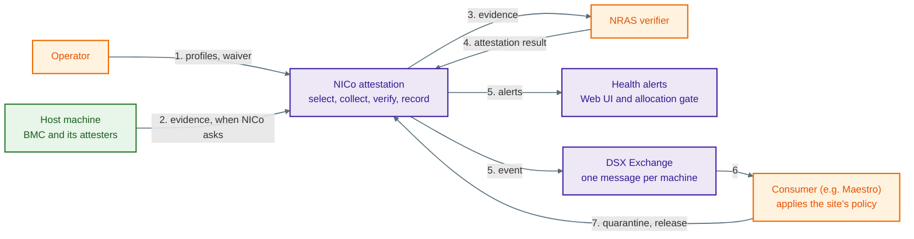
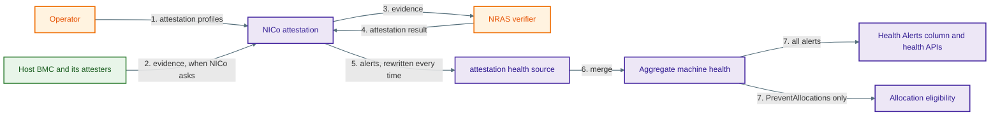

# SPDM Attestation Health Alerts

**Implements:** [dsx-ai-factory/infra-controller#4613](https://github.com/dsx-ai-factory/infra-controller/issues/4613)

**Depends on:** [dsx-ai-factory/infra-controller#7664](https://github.com/dsx-ai-factory/infra-controller/pull/7664), which re-keys attestation from the machine to a job. This document assumes that change has landed.

**Status:** Proposed

## Revision History

| Version | Date       | Modified By       | Description                                            |
| ------- | ---------- | ----------------- | ------------------------------------------------------ |
| 0.1     | 10/15/2026 | Binu Ramakrishnan | Initial version, scoped to issue 4613 only             |
| 0.2     | 10/16/2026 | Binu Ramakrishnan | Rebased onto job-driven attestation, #7664             |
| 0.3     | 10/16/2026 | Binu Ramakrishnan | Restructured around how each system works today        |

## 1 Purpose

Three machines look the same in the Health Alerts column today:

- one that attested every attester it has and passed
- one whose attestation failed
- one that was never attested because no profile covers its hardware

A failure shows up only as a generic `Failed` host state that an operator has to open the host to understand. A coverage gap shows up only as a fleet-wide counter that says how many machines are uncovered, not which ones.

This phase makes attestation a health-report source. A failed attester raises an alert, and that alert also blocks tenant allocation. Hardware that had a profile and could not satisfy it raises an informational alert. Hardware that no profile covers raises no alert, and §5.4 explains why.

### 1.1 How it fits together

NICo **reports** attestation state. It does not decide what to do about it.

| Who | Does what |
| --- | --- |
| NICo | Collects evidence, gets a result from the verifier, checks that result, records per-attester state, and reports it |
| Operator | Writes the policy that says which outcomes matter |
| Consumer | Reads the state, applies that policy, and calls NICo APIs such as `SetManagedHostQuarantineState` |

Two rules follow.

**Report what happened, not what to do.** NICo says a certificate chain was revoked. It does not say to update firmware or quarantine the machine. Those are policy decisions. If NICo made them too, the same policy would live in two places and drift apart.

**Report each attester.** A consumer might be told "quarantine a machine if two of its attesters fail". It can only apply a rule like that if NICo reports every attester alongside the deterministic machine-level rollup. A summary alone would hide information the consumer needs.

This is the whole picture attestation reporting is building toward, across every phase. The event bus, the consumer, and the waiver are all follow-up work (§7). §5 shows the part this phase builds.



The numbers follow one attestation around the loop. An operator writes a profile, NICo attests, the result reaches the health alerts and the bus, and the consumer applies the site's policy by calling NICo back. Both arrows out of NICo are numbered 5 because they are two outputs of the same step, not one after the other.

### 1.2 Current scope

This document covers the part of issue 4613 that can ship as one unit:

- an `attestation` health-report source
- one failure alert per failed attester, which blocks tenant allocation
- informational alerts where a profile applied but attestation covered less than it asked for, and no alert where no profile applied at all (§5.4)
- storing the few scheduling facts needed to rebuild the source
- keeping informational alerts off the frequent-republish path

A follow-up design handles the rest: typed failure reasons, the event-bus topic, the API snapshot, and the per-machine waiver. §7 lists both the gaps this leaves and the work that closes them.

## 2 Terms

| Term           | Meaning                                                                                       |
| -------------- | --------------------------------------------------------------------------------------------- |
| SPDM           | Security Protocol and Data Model, the DMTF standard for authenticating a hardware component and collecting signed measurements from it. NICo drives it through the BMC's Redfish interface |
| Attester       | An SPDM-capable component that a machine's BMC reports, such as a GPU or a NIC. Attestation selects, collects, and verifies per attester |
| Profile        | An operator-authored policy, one per hardware class, holding the selection below and carrying a version. The reserved class `any` is the fallback for classes with no profile of their own |
| Selection      | The part of a profile that says which attesters to attest: none of them, all of them, only the IDs matching a pattern, or all except those |
| Scheduling     | The step that decides what to attest. It resolves the machine's hardware class, finds the profile for that class, matches the profile's selection against the attesters the BMC reports, and creates the job. It always produces an outcome saying why it scheduled what it did (§5.4) |
| Job            | One scheduling attempt. A job covers the attesters selected for one machine at one moment and carries its own ID |
| Source         | The name a health report is stored under, such as `site-explorer` or `forge-dpu-agent`. A machine holds one report per source, and NICo merges them into the machine's overall health |
| Failure alert  | `SpdmAttestationFailed`, raised once for each attester that failed attestation. It blocks tenant allocation (§5.2) |
| Coverage alert | `AttestationNoAttesters` or `AttestationPolicyUnsatisfied`, raised when attestation did not cover what the profile asked for. A machine carries at most one, and it does not block allocation (§5.2) |
| Consumer       | The layer above NICo that applies the site's policy and calls NICo back, for example to quarantine a machine |
| Waiver         | A future per-machine exception that would let an operator accept a failed attestation for one machine. It does not exist yet (§7) |

## 3 How health alerts work today

Every machine stores one health report per source. `site-explorer`, `sku-validation`, and `forge-dpu-agent` are existing sources. NICo merges them into one aggregate report per machine, and a DPU's sources merge into its host's aggregate as well, so a DPU's alerts reach the host it belongs to.

An alert carries an ID, a target, a message, and an optional classification. Its identity is the ID and target together, so several alerts with the same ID coexist as long as their targets differ. The Health Alerts UI renders and filters whatever alert IDs it finds, so adding an ID needs no UI, protobuf, or OpenAPI change.

One thing about how alerts are read matters for everything below, because the readers disagree with each other.

**Allocation reads an alert's classification.** Of a machine's alerts, `is_usable_as_instance` rejects it only for one carrying `PreventAllocations`, so an alert with no classification cannot stop a machine from being handed to a tenant.

**Everything else only checks whether a machine has any alerts at all.** That is how the Managed Hosts view, the admin CLI, and the fleet healthy-count metric decide. So does the republisher, the background job that re-sends each host's state to the event bus in case a consumer missed an update. To all of them, one alert of any kind makes a machine unhealthy. The republisher then treats the two differently: unhealthy hosts go out on every sweep, healthy ones less often.

So an alert deliberately left unclassified still shows its machine as unhealthy everywhere except allocation. This design raises exactly that kind of alert, which is why §5.4 and §6 keep coming back to it.

## 4 How SPDM attestation works today

Nothing runs until `spdm.enabled` is on, and it defaults to `false`.

An operator writes attestation profiles keyed by hardware class, plus a reserved `any` profile that covers classes with no profile of their own.

Scheduling then works in two stages, and which stage decided matters later. It first **resolves a profile**: it looks up the class recorded for the machine's BMC and finds the profile for that class, falling back to `any`. If neither exists, scheduling stops there, because there is no policy to apply. It then **evaluates that profile's selection** against the attesters the BMC reports, which decides which of them to attest.

Either stage can end the attempt, and either way scheduling returns an outcome saying what it decided and why (§5.4). When attesters were selected, it also writes one database row per attester under a new job ID. When none were, it creates no job and no rows.

The SPDM controller then works each row on its own: firmware version, certificate, evidence collection from the BMC, verification by NRAS, appraisal, and finally `Passed`, `Failed`, or `Cancelled`. A machine with eight GPUs has eight of these running independently and possibly at different stages. Asking how a whole job turned out is a single query. Completed jobs are not deleted right away: the newest ten per machine are kept, so a machine can hold rows from several past jobs.

### 4.1 When attestation can start

The host state machine starts attestation at ingestion, before assignment, and at release. The `TriggerMachineAttestation` RPC starts one whenever an operator asks, including on a host sitting idle in `Ready`. Periodic attestation is a stated requirement and is not built yet; when it arrives, attestation can begin in any lifecycle state, including while a host is assigned to a tenant.

That matters for this design. Attestation tied to a lifecycle stage can report failure by moving the host to `ManagedHostState::Failed`, which is what happens today. Attestation that starts while a host is assigned cannot: nothing can usefully move that host, so a health alert is the only thing NICo can produce. Health alerts are therefore the one reporting mechanism that works from every starting point, which is the reason this phase exists.

### 4.2 The subject is a host or DPU

A machine row is either a host or a DPU. Each has its own row and its own BMC, and the attestation tables key on the machine without caring which kind it is.

Starting attestation and carrying it out are done by different code. That is how a DPU gets attested even though the host state machine never attests one:

- **The host state machine starts attestation for hosts only.** It loads its work by excluding every machine whose ID carries the DPU prefix, so a DPU row is never in the set it drives.
- **The `TriggerMachineAttestation` RPC starts it for any machine.** It looks the machine up by ID and uses that machine's own BMC, with no host check. An operator who names a DPU attests that DPU through the DPU's BMC.
- **The SPDM controller carries out whatever was started.** It sweeps every device row that has not completed, with no machine-type filter at all, so it drives a DPU's rows the same as a host's.

So a DPU is attested today whenever an operator asks for it, and reporting in this phase has to work for a DPU subject as well as a host one.

## 5 Deriving health alerts from attestation

The source is named `attestation`. It is what NICo claims about the machine right now, not a log of what each job did. Every write replaces all of its alerts at once. NICo builds the complete list from the stored scheduling decision (§5.3) and the attesters' results, then stores that list over whatever was there before. It never adds or removes a single alert inside an existing report.

The reason is that two different writers produce this source (§5.1). If each one edited the alerts already there, the result would depend on which writer ran last. Building the whole list from stored data gives the same report either way.

Each write goes on the row of the machine being attested, so a DPU's alerts are stored on the DPU's own row. When the list comes out empty, the source is deleted rather than stored with no alerts in it.



The two arrows numbered 7 share a number because the aggregate feeds both at once. Everything in this diagram already exists except the health source itself: this phase adds the source and the alerts it writes, and the aggregate, the column, and the allocation gate all consume it with no changes of their own.

### 5.1 Why two writers

The source is written twice for each attestation, because the two halves of what it reports become known at different moments.

**Scheduling writes it, because the outcomes that most need reporting create no job.** `NoProfile`, `ClassNotRecorded`, `NoAttestersFound`, `PolicyMatchedNothing`, and `AttestationDisabled` all end immediately, with no job and no rows. There is no later moment for them. If scheduling did not write, a machine whose profile asked for something the BMC could not supply would never be reported at all.

**The SPDM controller writes it when a job finishes, because only then do results exist.** It writes once the job's last device reaches `Passed`, `Failed`, or `Cancelled`, reading that job's rows.

The two writes are not redundant. Scheduling knows what the profile asked for and has no results. The terminal write has the results but never re-runs selection, so it cannot see what scheduling decided. §5.3 is what carries the first across to the second.

Each write covers only its own job. Older jobs are retained history, not a claim NICo is currently making, so a machine holding failed rows from an earlier job and passed rows from a newer one reports the newer one.

**Two jobs can run at once.** Nothing stops an operator triggering attestation while a job is still running, and the second attempt creates a second job rather than disturbing the first. The stored decision (§5.3) keeps only the latest, so it always describes the newest job. Each terminal write therefore reports only when the stored decision names its own job:

1. Job A is scheduled. The stored decision names A.
2. Job B is scheduled before A finishes. The stored decision now names B, and A's is gone.
3. A finishes. The stored decision names B, so A writes nothing.
4. B finishes. The stored decision names B, so B writes.

A's results are never reported, and that is the intent: by step 3 the operator has already replaced A's decision with B's. Without the check, A would pair its own results with B's decision, and the two usually differ, because the common reason to trigger again is that the operator has just edited the profile.

### 5.2 Alert IDs

| Alert ID                       | Raised when                                       | Target                      | Classification       |
| ------------------------------ | ------------------------------------------------- | --------------------------- | -------------------- |
| `SpdmAttestationFailed`        | Each attester in `Failed`, one alert per attester | Attester ID                 | `PreventAllocations` |
| `AttestationNoAttesters`       | `NoAttestersFound`                                | Hardware class, if recorded | None                 |
| `AttestationPolicyUnsatisfied` | `PartiallySatisfied` or `PolicyMatchedNothing`    | Hardware class, if recorded | None                 |

A machine can carry several `SpdmAttestationFailed` alerts at the same time, one for every attester that failed. They stay separate instead of merging into one, because an alert is identified by its ID and its target together, and each of these targets a different attester.

The other two IDs behave the opposite way. A machine carries at most one of them, because each comes from a single scheduling decision rather than from a device. There is no component for such an alert to point at, so it targets the hardware class instead. These two are the coverage alerts (§2).

Both kinds can appear together. `PartiallySatisfied` still schedules the attesters that did match, so a machine can carry a coverage alert for the pattern that matched nothing and a failure alert for each scheduled attester that then failed. They answer different questions: one is about what the profile asked for, the other about what a device reported.

Messages explain the decision rather than repeat the alert ID. A coverage alert names the profile that applied, the selection that went unsatisfied, and the profile version, so an operator can see which revision decided. A failure alert carries the stored failure text as its message, which this phase neither categorizes nor caps.

### 5.3 Storing what scheduling decided

Scheduling works out the outcome, the hardware class, the profile version, and whether the `any` profile supplied the policy. It returns them to its caller and nothing writes them down. The terminal write needs them to build a coverage alert, and an operator needs them to ask which machines are uncovered.

So scheduling stores them on the machine, in one nullable `jsonb` column rewritten in full on every run. Latest decision only, no history. A machine that has never been scheduled has `NULL`. The record also names the job it created, which the terminal write checks before reporting (§5.1).

It is stored rather than worked out later, for two reasons. The outcome depends on which attesters the BMC reported at that moment, and that list is never kept. And `attestation_profiles` holds one row per hardware class with no history, so a later lookup returns the profile as it stands then, not the one that decided.

It is stored on the machine rather than on the job because five of the seven outcomes in §5.4 create no job, and those five are the cases the coverage alerts describe.

The migration is one statement, additive, and applies while a `nico-api` instance is still writing:

```sql
-- Records what attestation scheduling decided, so health alerts can be built
-- from it. The decision depends on which attesters the BMC reported at the
-- time, and those are not stored, so it cannot be derived from the profile.
ALTER TABLE machines
    ADD COLUMN attestation_scheduling jsonb;
```

The column holds one object with the same five keys every time. A value that does not apply is `null` rather than a missing key.

| Key                 | Type              | Value                                                                                                     |
| ------------------- | ----------------- | --------------------------------------------------------------------------------------------------------- |
| `outcome`           | string            | One of the seven outcomes in §5.4, spelled as the enum is                                                 |
| `hardware_class`    | string or `null`  | The class recorded for the machine's BMC, in `<manufacturer>_<model>` form. `null` when none is recorded  |
| `used_any_fallback` | boolean           | Whether the reserved `any` profile supplied the policy                                                    |
| `profile_version`   | string or `null`  | The version of the profile that decided, in `V<number>-T<microseconds>` form. `null` when none applied    |
| `job_id`            | string or `null`  | UUID of the job this attempt created. `null` when it created none                                         |

`hardware_class` is `null` when no class was recorded, not the empty string `SchedulingResult` carries for the proto response.

A machine whose profile named an attester the BMC did not offer, with the ones that did match scheduled anyway:

```json
{
  "outcome": "PartiallySatisfied",
  "hardware_class": "nvidia_dgx-h100",
  "used_any_fallback": false,
  "profile_version": "V7-T1760631000000000",
  "job_id": "7c3f1f0e-1d2a-4f7b-9a21-0b5e3c8d41a6"
}
```

A machine whose class has no profile. It raises no alert (§5.4), so this record is what answers the uncovered-machines query:

```json
{
  "outcome": "NoProfile",
  "hardware_class": "nvidia_mgx-power-shelf",
  "used_any_fallback": false,
  "profile_version": null,
  "job_id": null
}
```

Nothing else in this phase changes the schema. Health reports already live in `machines.health_reports`, which holds one report per source, so a new source is one more entry in it. The queries the writer needs already exist, keyed by job.

### 5.4 Which alert each outcome raises

Scheduling always ends in one of seven outcomes. Four of them raise no alert, and the rest of this section is about why.

| Outcome                | Decided by         | Meaning                                                                             | Alert                          |
| ---------------------- | ------------------ | ----------------------------------------------------------------------------------- | ------------------------------ |
| `Scheduled`            | Selection          | Every selected requirement was satisfied and a job was created                       | None                           |
| `PartiallySatisfied`   | Selection          | Some allowlist patterns matched nothing; the matched attesters were still scheduled | `AttestationPolicyUnsatisfied` |
| `PolicyMatchedNothing` | Selection          | A requirement the operator wrote matched nothing, leaving nothing to attest         | `AttestationPolicyUnsatisfied` |
| `NoAttestersFound`     | Selection          | A profile applied, but the BMC offered no eligible attester                         | `AttestationNoAttesters`       |
| `AttestationDisabled`  | Selection          | The applicable profile uses `mode: NONE`                                            | None                           |
| `ClassNotRecorded`     | Profile resolution | Exploration has recorded no hardware class, and no `any` profile applied            | None                           |
| `NoProfile`            | Profile resolution | A class was recorded, but neither it nor `any` has a profile                        | None                           |

`Scheduled` has nothing to report, and `AttestationDisabled` is an operator's decision rather than a gap.

`NoProfile` and `ClassNotRecorded` raise no alert **in this phase**, which narrows what issue 4613 describes. The issue asks for a label when attestation did not cover what the policy asked for, and in these two cases no policy applied at all.

It also avoids a fleet-wide effect. At a site that enables SPDM before writing any profile, every machine lands on one of these two outcomes, and most surfaces read emptiness rather than classifications (§3). An alert on each machine would show the whole fleet as unhealthy while leaving it allocatable.

Uncovered machines are still findable: the stored decision (§5.3) records the outcome on every machine, so which ones are uncovered is a query. An `AttestationNotCovered` alert can be added later if that is not enough.

### 5.5 Clearing alerts

No alert is ever cleared on its own. Each write replaces the whole source (§5), so an alert goes away by not being in the next write. An attestation that creates a job writes twice:

- **When scheduling creates the job**, the write holds the new decision's coverage alerts and no failure alerts. This is where the previous job's failure alerts go away.
- **When the job finishes**, the write holds those same coverage alerts plus one failure alert per failed attester.

An attestation that creates no job writes once, at scheduling, since no result ever follows.

The previous job's rows are still in the database. They stop showing up because each write reads only the current job.

So a failure alert clears at the next attestation, not when an operator fixes the machine. Fixing it means attesting again.

**A missing alert does not mean the problem is fixed.** An operator can narrow an allowlist so NICo no longer attests a given attester. The next job has no row for it, so its earlier failure disappears from the report even though nothing changed on the machine. That is intended, because NICo should not keep making claims about an attester it is not attesting. But a missing failure means "NICo is not claiming anything right now", not "the problem is fixed".

## 6 Decisions and consequences

**Only failure alerts block allocation.** A failed attestation never established that the machine is safe to hand to a tenant, so NICo fails closed. A coverage alert means nothing about the machine was examined, so the problem is in the profile or the inventory. Blocking on it would make a newly racked hardware class unallocatable over a configuration mistake.

The allocation gate is a backup today. A host that fails attestation already stops in `ManagedHostState::Failed`, so it never joins the pool at ingestion and never reaches cleanup at release. The gate only stops a machine that is already `Ready` from being picked. It becomes the primary hold if the state machine moves to Wait substates (§7).

**A coverage alert still shows as unhealthy.** Most surfaces read emptiness rather than classifications (§3), so a coverage alert makes a machine look unhealthy even though it stays allocatable. §5.4 keeps that off a whole fleet. One case remains: setting the `any` profile to `mode: ALL` gives every class a policy, so a device with no attesters of its own, such as a power shelf, ends at `NoAttestersFound` and raises an alert. The profile design already recommends the fix, which is `mode: NONE` for a class with nothing to attest.

**The republisher rule reaches other health sources.** A coverage alert can last for days, until an operator reconciles the profile with the hardware, and today any alert at all makes a machine unhealthy for republishing. Every machine of a mismatched class would publish on every sweep for that whole time. So for republishing, unhealthy becomes "has an alert with at least one classification": failure alerts keep publishing every sweep, and informational ones drop to the healthy cadence. The rule applies to every source rather than to attestation alone, and it is the only change here that SPDM does not gate, so it needs its own release note.

**Nothing happens until SPDM is on.** `spdm.enabled` defaults to `false` and gates every trigger point, so a site that has not enabled SPDM sees no new alerts and nothing stored. Everything above except the republisher rule applies only to sites that have it on.

## 7 Not in this phase

These are known gaps, listed so nobody expects more from the Health Alerts column than it delivers.

**There is no per-machine override.** The only ways out of a failed attestation are attesting again or turning `spdm.enabled` off site-wide. Removing the attester from the profile also works, but it affects every machine of that hardware class. A per-machine waiver is follow-up work.

**Failure text stays unstructured.** Two very different failures read the same to software: a device whose evidence the verifier rejected, and a verifier NICo could not reach. A person can read the message and tell them apart. A program cannot match on it safely. Typed failure categories and reasons are follow-up work, and they can improve the message without changing the alert ID, target, or classification this phase establishes.

**A green column does not prove verification happened.** When the Redfish driver cannot read an attester's firmware version, the pipeline records that attester as `Passed` without fetching a certificate, collecting evidence, or calling the verifier. The default `libredfish` implementation answers that way for every component, so on a BMC with no vendor driver every selected attester passes this way and the outcome still says `Scheduled`. This phase reports those machines as healthy because that is what the pipeline decides. Changing it turns them into failures, which cannot ship before the waiver.

**Uncovered machines look the same in the column.** A machine whose class has no profile raises no alert (§5.4), so it looks like one that attested everything. The stored decision and the scheduling metric answer that question instead.

**Nothing reaches the event bus.** A consumer has to read the API. The attestation event topic, and the API snapshot and revision that go with it, are follow-up work.

**Wait substates may replace `Failed`.** A failed attestation moves the host to a generic `ManagedHostState::Failed`, and a recovery handler works out how to return it to the state it came from. Replacing that with a Wait substate at each of the three attestation points is being considered separately. It would make the allocation gate the primary hold rather than the backup (§6).

## 8 Implementation

| #   | Change                                                                                       | Crate                                                 |
| --- | -------------------------------------------------------------------------------------------- | ----------------------------------------------------- |
| 1   | Store what scheduling decided, including the job ID, on the trigger path                     | `api-db` migration, `api-model`, `machine-controller` |
| 2   | `ATTESTATION_SOURCE`, the three alert IDs, and the alert constructors                        | `health-report`                                       |
| 3   | `update_attestation_health_report`, the complete-source writer                               | `api-db`                                              |
| 4   | Call the writer from inside `trigger_attestation`, so the RPC path writes it too             | `machine-controller`                                  |
| 5   | Call the writer when a job reaches terminal, if the stored decision names that job           | `spdm-controller`                                     |
| 6   | `is_report_unhealthy` counts only classified alerts                                          | `api-core`                                            |
| 7   | Document the three alert IDs in [`health_probe_ids.md`](../../architecture/health/health_probe_ids.md) | n/a, documentation                           |

Step 1 has to land before steps 3 to 5, since the writer cannot build a correct report before that decision exists to read. Step 1 is also the only step with a migration (§5.3), and step 2 adds `ATTESTATION_SOURCE` next to the existing `SITE_EXPLORER_SOURCE` and `SKU_VALIDATION_SOURCE`. Step 6 depends on none of the others, and it is the only step that changes behavior for health sources other than `attestation` (§6).

## 9 Testing

| Proof                                                                                                                                 | Where                                  |
| --------------------------------------------------------------------------------------------------------------------------------------- | -------------------------------------- |
| Each of the seven scheduling outcomes raises the alert §5.4 lists for it, including the four that raise none                         | `machine-controller` tests             |
| With SPDM on and no profiles written, no machine carries an attestation alert                                                        | `api-core` integration test            |
| Each failed attester gets its own `SpdmAttestationFailed` alert, targeted at that attester and carrying `PreventAllocations`         | `spdm-controller` tests                |
| When a job finishes, the write rebuilds the coverage alert from the stored decision and adds one failure alert per failed attester    | `spdm-controller` tests                |
| A failed attester on a DPU stores its alert on the DPU's row and blocks allocation of the DPU's host                                 | `api-core` integration test            |
| A machine with a failed older job and a passed newer job reports only the newer job                                                  | `spdm-controller` tests                |
| A job that finishes after a newer one was scheduled writes no alerts                                                                 | `spdm-controller` tests                |
| A coverage alert on a machine with no recorded hardware class has no target                                                          | `machine-controller` tests             |
| Coverage alerts do not prevent allocation                                                                                            | `api-core` health aggregation tests    |
| An attestation with no alerts to report deletes the source instead of storing an empty one                                           | `api-core` health aggregation tests    |
| The trigger RPC writes the source just as a state-machine trigger does                                                               | `api-core` integration test            |
| Scheduling a new job clears the previous job's failure alerts before any result exists                                               | `api-core` integration test            |
| The `attestation` source merges with `site-explorer` and `forge-dpu-agent` without replacing either                                  | `api-core` health aggregation tests    |
| A machine carrying only coverage alerts republishes at the healthy cadence; one carrying a failure alert publishes on every sweep     | `api-core` republisher tests           |
