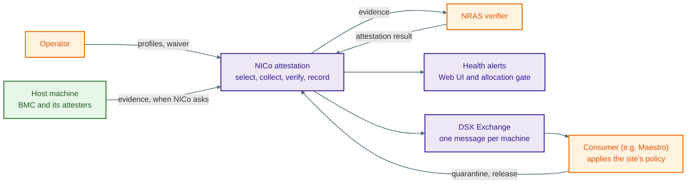
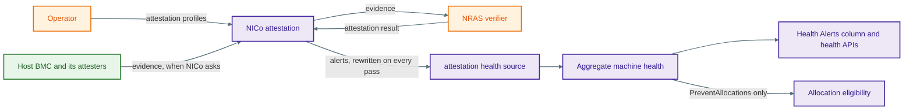

# SPDM Attestation Health Alerts

**Implements:** [dsx-ai-factory/infra-controller#4613](https://github.com/dsx-ai-factory/infra-controller/issues/4613)

**Status:** Proposed

## Revision History

| Version | Date       | Modified By       | Description                                |
| ------- | ---------- | ----------------- | ------------------------------------------ |
| 0.1     | 10/15/2026 | Binu Ramakrishnan | Initial version, scoped to issue 4613 only |

## 1 Purpose

Three machines look the same in the Health Alerts column today:

- one that attested every root of trust it has and passed
- one whose attestation failed
- one that was never attested, because no profile covers its hardware

A failure shows up only as a generic `Failed` host state that an operator has to open the host to understand. A coverage gap shows up only as a fleet-wide counter that says how many machines are uncovered, but not which ones.

This design makes attestation a health-report source. A failed attester raises an alert, and that alert also blocks tenant allocation. Hardware that had a profile and could not satisfy it raises an alert too.

The third case is handled differently. Hardware that no profile covers raises no alert. Instead NICo stores the scheduling outcome on each machine, so an operator can query which machines are uncovered. §4.2 explains why, and §6 says what that leaves open.

### 1.1 Who decides what

NICo **reports** attestation state. It does not decide what to do about it.

| Who | Does what |
| --- | --- |
| NICo | Collects evidence, gets a result from the verifier, checks that result, records per-attester state, and reports it |
| Operator | Writes the policy that says which outcomes matter |
| The layer above NICo | Reads the state, applies that policy, and calls NICo APIs such as `SetManagedHostQuarantineState` |

Two rules follow.

**Report what happened, not what to do.** NICo says a certificate chain was revoked. It does not say to update firmware or quarantine the machine. Those are policy decisions. If NICo made them too, the same policy would live in two places and drift apart.

**Report each attester.** A consumer might be told "quarantine a machine if two of its attesters fail". It can only apply a rule like that if NICo reports every attester alongside the deterministic machine-level rollup. A summary alone would hide information the consumer needs.

NICo does keep one decision: whether to hand a machine with a failed attestation to a tenant. It owns allocation, so it cannot pass that on. It refuses. Lifting that refusal for a single machine is follow-up work (§6); in this phase the only ways out are another attestation pass or the site-wide switch.

### 1.2 How it fits together

This is where attestation reporting is going, across every phase. The event bus, the consumer, and the waiver are all follow-up work (§6). §1.4 shows the part this phase builds.



The loop runs around the outside. An operator writes a profile, NICo attests, the result reaches the health alerts and the bus, and the consumer applies the site's policy by calling NICo back.

Inside NICo, each attester runs the same pipeline independently, so a machine with eight GPUs has eight pipelines that can sit at different stages at once. The machine-level status in the API is a rollup of them.

### 1.3 Current scope

This document covers the part of issue 4613 that can ship as one unit:

- an `attestation` health-report source
- one failure alert per failed attester, which blocks tenant allocation
- informational alerts where a profile applied but attestation covered less than it asked for, and no alert where no profile applied at all (§4.2)
- storing the few scheduling facts needed to rebuild the source
- keeping informational alerts off the frequent-republish path

A follow-up design handles the rest: typed failure reasons, the event-bus topic, the API snapshot, and the per-machine waiver. §6 lists the gaps this leaves, and §9 lists the work that closes them.

This phase changes no attestation behavior. It reports what the pipeline already does.

### 1.4 Health alert flow

This phase builds the health-alert half of §1.2. There is no event bus and no consumer here: a reader gets the alerts from the API.



Everything to the left of the health source already exists. This phase adds the source and the two arrows leaving it. An operator writes profiles and reads the column. The layer above NICo does not have to do anything new.

## 2 What exists today

| Surface                                                                                                           | Attestation state                                                      |
| ----------------------------------------------------------------------------------------------------------------- | ---------------------------------------------------------------------- |
| Aggregate machine health, read by the Health Alerts column, gRPC `MachineStatus.health`, and REST `MachineHealth` | No attestation alerts. The data is missing, not just hidden from view  |
| State machine                                                                                                     | A terminal failure becomes `ManagedHostState::Failed` with text detail |
| Trigger RPC and metrics                                                                                           | Report the scheduling outcome, but do not persist it                   |

Two things that already exist keep this small. First, the Health Alerts UI renders and filters whatever alert IDs it finds in `aggregate_health.alerts`, so a new ID needs no UI, protobuf, or OpenAPI change. Second, `attestation` becomes a source alongside `site-explorer` and `sku-validation`, which already merge into one aggregate report per machine.

### 2.1 The two paths that must write health

Attestation does not run on a timer. Two things start it. The host state machine starts a pass at ingestion, before assignment, and at release. The `TriggerMachineAttestation` RPC starts one whenever an operator asks. Either way, a pass runs in two steps:

- **The trigger path** runs once, at the start of a pass. It picks the attesters from the profile and writes one row per selected attester. It knows what was selected, but no attester has a result yet.
- **The poll path** runs again on every controller iteration while the pass is active. Most iterations do nothing, because the machine rollup is still `InProgress`. The **terminal** poll is the one iteration where the rollup has become `Passed`, `Failed`, or `Cancelled`.

Neither step knows the whole story. The trigger knows the coverage decision but has no results yet. The terminal poll has the results but never re-runs selection, so it cannot see what the trigger decided. §3 is what bridges them.

The subject of a pass is a machine, and a machine is a host or a DPU. Each has its own `machines` row and its own BMC, and the attestation tables key on `machine_id` without caring which it is. `SpdmDeviceAttestation` says so directly: its `machine_id` is a "Host or DPU's machine id". The state machine only ever attests a host, because it drives host rows alone. The RPC attests whichever machine an operator names. So the reporting in this phase has to work for a DPU subject as well as a host one.

## 3 What has to be stored

The trigger RPC returns the scheduling outcome, but nothing stores it. So the terminal poll cannot separate two very different machines: one that attested everything and passed, and one that attested nothing at all. Both end a pass with no failed rows.

The trigger therefore stores a scheduling snapshot: the outcome, the resolved hardware class, the profile version, and whether the reserved `any` profile supplied the policy. This is one nullable `jsonb` column on `machines`, not a table. It holds the current fact for each machine and is replaced on every trigger, so it is not a history. A machine that has never been scheduled has `NULL`.

The health writer reads only the outcome and the class. The other two fields are stored because nothing else keeps them: a later trigger replaces the work rows, and an operator can edit a profile between reading it and seeing a surprising result. They fit in the same column at no extra cost, and they let an alert name the profile revision that made the decision.

### 3.1 Scheduling outcomes

| Outcome                | Meaning                                                                             |
| ---------------------- | ----------------------------------------------------------------------------------- |
| `Scheduled`            | Every selected requirement was satisfied and work rows were created                 |
| `PartiallySatisfied`   | Some allowlist patterns matched nothing; the matched attesters were still scheduled |
| `PolicyMatchedNothing` | A requirement the operator wrote matched nothing, leaving nothing to attest         |
| `NoAttestersFound`     | A profile applied, but the BMC offered no eligible attester                         |
| `ClassNotRecorded`     | Exploration has recorded no hardware class, and no `any` profile applied            |
| `NoProfile`            | A class was recorded, but neither it nor `any` has a profile                        |
| `AttestationDisabled`  | The applicable profile uses `mode: NONE`                                            |

The hardware class is absent for `ClassNotRecorded`. The profile version is absent when no profile applied.

### 3.2 Clearing stale attester rows

Today the scheduling code replaces a machine's attester rows only when it has attesters to schedule. When it picks none, the handler returns before it gets that far, and the rows from the last pass stay in the table. If this phase wrote only the new health source, those rows would still be there: the health column would show nothing wrong, while the machine attestation status kept reporting `Failed` from the old rows.

So every outcome now writes the rows too. If it picks attesters, it replaces the old rows. If it picks none, it deletes them.

Deleting the rows breaks something that has to be fixed in the same change. `list_single_machine_attestation_status` returns a not-found error for a machine with no rows, and two state handlers pass that error up instead of handling it. This phase changes that function to return `Option<SpdmAttestationStatus>`, so "no rows" becomes a value a caller can read, and each caller decides what it means:

- `handle_spdm_attestation_failed_recovery` treats a missing status as resume. It already does this when `spdm_enabled` is off for the whole site, and for the same reason: NICo is no longer claiming anything about this machine's attestation, so the failure that stopped it no longer applies.
- `handle_spdm_poll_state` treats a missing status as skip. It moves to the same next state the trigger path uses when there is no work to do.
- The `SpdmListAttestationMachines` RPC still returns not found. For a read API that is the right answer (§5).

Both handlers have to change at once. Recovery always resumes into the poll state, never the trigger state. The poll state skips on its own only when `spdm_enabled` is off for the whole site, and a profile that asks for no work leaves `spdm_enabled` on. So fixing recovery by itself would move the host out of `ManagedHostState::Failed` and into a poll state that errors on every iteration. The host still would not move forward, and it would no longer show a reason. That is worse than the problem it was meant to fix.

Here is the case this unblocks. An operator sets `mode: NONE` for a hardware class, then re-triggers attestation on a host that is already sitting in `ManagedHostState::Failed`. Editing the profile on its own does not reach that host, because a failed host never runs the trigger path. The case is already a dead end today: the trigger finds no work, leaves the old `Failed` rows in place, recovery reads them, and the only way out is the site-wide switch. This phase does not create the dead end, but it has to close it, because deleting the rows changes the way it fails.

### 3.3 Database changes

One migration, one statement. The snapshot is a new nullable `jsonb` column on `machines`:

```sql
-- Attestation scheduling decides what to attest before any result exists.
-- Storing that decision lets the health source be rebuilt from either handler.
ALTER TABLE machines
    ADD COLUMN attestation_scheduling jsonb;
```

Nullable with no default, because a machine that has never been scheduled genuinely has no snapshot. The column is replaced as a whole on every trigger, so its contents must deserialize into the current Rust type. The change is additive and applies while a `nico-api` instance is still writing.

Nothing else in this phase changes the schema:

| Change                                             | Why it needs no migration                                                                                                                                                                  |
| -------------------------------------------------- | ------------------------------------------------------------------------------------------------------------------------------------------------------------------------------------------ |
| The `attestation` health source                    | Health reports already live in `machines.health_reports`, keyed by source under `merges`. A new source is a new key, and `machine_health_reports_merges_gin_idx` already indexes that path |
| Deleting attester rows for no-work outcomes (§3.2) | A new `DELETE` against the existing `spdm_machine_devices_attestation` table                                                                                                               |
| The missing-status answer in both handlers (§3.2)  | Rust only. The query already returns no row for a machine with no attester rows; only the Rust return type changes                                                                         |
| The republisher rule (§7 step 7)                   | Rust only                                                                                                                                                                                  |

A purely additive nullable column has no data semantics to verify, so it needs no predecessor-schema test. See the migration guidance in [`AGENTS.md`](../../../AGENTS.md).

## 4 The health source

The source is named `attestation`. It is always rewritten in full from the stored scheduling snapshot and the current attester rows, and it is written to the subject's own `machines` row, whether that subject is a host or a DPU. Both writers call the same function, and neither one reads the existing report to edit single alerts.

Rewriting the whole source means it always matches what is stored. If the two paths read and edited instead, the report would depend on which handler happened to run last. When the rewrite produces no alerts, the source is deleted.

### 4.1 Alert IDs

| Alert ID                       | Raised when                                       | Target                      | Classification       |
| ------------------------------ | ------------------------------------------------- | --------------------------- | -------------------- |
| `SpdmAttestationFailed`        | Each attester in `Failed`, one alert per attester | Attester ID                 | `PreventAllocations` |
| `AttestationNoAttesters`       | `NoAttestersFound`                                | Hardware class, if recorded | None                 |
| `AttestationPolicyUnsatisfied` | `PartiallySatisfied` or `PolicyMatchedNothing`    | Hardware class, if recorded | None                 |

The two kinds of alert differ in how many a machine can carry. The failure alert repeats: a machine with three failed attesters carries three `SpdmAttestationFailed` alerts, one per attester. They stay separate because an alert is identified by its ID and its target together, and each one has a different target. The coverage alert comes from the single scheduling snapshot, so a machine carries at most one.

Both kinds can appear together. `PartiallySatisfied` still schedules the attesters that did match, so one machine can carry an `AttestationPolicyUnsatisfied` alert for the pattern that matched nothing and a `SpdmAttestationFailed` alert for each scheduled attester that then failed. They answer different questions: one is about what the profile asked for, the other about what a device reported.

The different shapes are not a choice. A target names a component, and a failed attester is one, so each failure keeps its own target and stays a separate alert. A pattern that matched nothing has no component to name, so every alert for one would carry the same hardware class as its target and merge into a single entry. Naming the unsatisfied selection in the message is the only way to report it.

Most machines that raise a coverage alert have a recorded hardware class, but not all. The reserved `any` profile applies even when exploration has recorded no class, so a machine can reach `NoAttestersFound` with the class empty. That alert then has no target, and its message says the BMC has not been classified.

Each message explains the decision instead of repeating the alert ID. `AttestationNoAttesters` says which profile applied and that the BMC reported no SPDM-capable component. `AttestationPolicyUnsatisfied` names the selection that went unsatisfied. Both include the profile version from the snapshot, so an operator can see which revision made the decision.

### 4.2 Outcomes that raise nothing

Four outcomes raise no alert. For two of them, that is a deliberate narrowing of what issue 4613 describes.

`Scheduled` has nothing to report. `AttestationDisabled` means an operator switched attestation off for a hardware class, which is a decision rather than a gap.

`NoProfile` and `ClassNotRecorded` raise nothing **in this phase**. The issue asks for an informational label "when attestation did not cover what policy asked for". In these two cases no policy asked for anything. One is hardware whose class has no profile. The other is hardware that exploration has not classified yet. Neither has an unmet expectation to report, only an absence.

Leaving them out also avoids the one effect of this phase that a whole fleet would have felt. At a site that enables SPDM before writing any profile, every machine lands on one of these two outcomes. The Managed Hosts view, the admin CLI, and the fleet healthy-count metric all decide healthy versus unhealthy by checking whether the alert list is empty, not by reading classifications. So an informational alert on every machine would have shown a whole fleet as "Unhealthy" while leaving it allocatable. Raising coverage alerts only where a policy existed removes that case rather than managing it, and it needs no change to any of those three surfaces.

An operator can still find the uncovered machines without an alert. The scheduling snapshot (§3) records the outcome on each machine, so "which machines are uncovered" becomes a query. That is the gap the issue actually describes when it says the existing counter reports how many machines are uncovered but not which ones. For the fleet-wide count, `carbide_attestation_scheduling_total` already carries `outcome="no_profile"` and `outcome="class_not_recorded"`.

An `AttestationNotCovered` alert can be added later without changing anything else. The UI renders and filters whatever alert IDs it finds, so a new ID needs no code change there. By then the waiver and typed failure reasons will exist alongside it.

### 4.3 Failure alerts

This phase does not need typed failure categories. The writer uses the failed attester row as it stands. Each alert carries the alert ID, the attester ID as its target, the stored failure text as its message, and `PreventAllocations`.

`HealthProbeAlert.message` has no length limit, and no other health source caps what it writes, so this phase does not cap it either. If verifier text turns out to be long enough to matter, a cap is a separate decision to make across all sources rather than for attestation alone.

A later design replaces the internal `Failed(String)` with typed category and reason fields. That change can improve the message without changing the alert ID, target, or classification this phase establishes.

### 4.4 Allocation behavior

Only `SpdmAttestationFailed` carries `PreventAllocations`. NICo fails closed here: an attestation that did not succeed never established that the machine is safe to hand to a tenant. Allocation is also the one decision NICo cannot pass to the layer above it.

The coverage alerts carry no classification. They report that attestation covered less than a profile asked for, which is a profile or inventory problem rather than a failed check, because nothing about the machine was examined and rejected. Without this, a newly racked hardware class whose profile does not match what the BMC reports would become unallocatable because of a configuration mistake.

The gate is not the only thing holding a failed machine. The state machine already stops the host in `ManagedHostState::Failed`, and that is the stronger of the two. A machine that fails at ingestion never joins the pool, and one that fails at release never reaches cleanup. `PreventAllocations` only stops a ready machine from being picked for a new tenant.

### 4.5 Clearing alerts

The trigger path rewrites the source at the start of a pass, so a new pass drops the previous pass's failure alerts. What replaces them depends on the outcome. An outcome with a coverage alert writes that alert. An outcome that raises nothing (§4.2) leaves the source with no alerts, so it is deleted rather than left empty. The terminal poll then rewrites the source again from both inputs. The snapshot has not changed, so any coverage alert is derived a second time, and one `SpdmAttestationFailed` alert is added per failed attester, or none if the pass passed or was cancelled.

A failure alert therefore clears on the next attestation pass, not at the moment an operator fixes the machine. Fixing it means triggering attestation again.

**A missing alert does not mean the problem is fixed.** An operator can narrow an allowlist so NICo no longer attests a given attester. The next pass drops that attester's row, so its earlier failure disappears even though nothing changed on the machine. That is what we want, because NICo should not keep making claims about an attester it is not attesting. But a reader has to treat a missing failure as "NICo is not claiming anything right now", not "the problem is fixed".

### 4.6 Keeping informational alerts quiet

NICo publishes a managed host's state to the event bus whenever it changes. A consumer that cannot poll the API could miss one of those messages, so a background sweep also re-publishes current state on a timer. That sweep is the republisher, and it sends unhealthy hosts every time and healthy ones less often. It decides which is which with one check:

```rust
fn is_report_unhealthy(report: &HealthReport) -> bool {
    !report.alerts.is_empty()
}
```

Unhealthy machines publish on every sweep. A coverage alert lasts until an operator reconciles the profile with the hardware, which can take days. Without a change, every machine of a mismatched hardware class would publish on every sweep for that whole time. Under `RepublishScope::All` it would ignore `healthy_republish_every`. Under `RepublishScope::UnhealthyOnly` those machines would be the only ones publishing at all.

So for republishing, unhealthy becomes "has an alert with at least one classification". Failures that block allocation keep publishing every sweep, and informational alerts stay on the normal healthy cadence. The same rule covers any informational alert added later.

## 5 Effect on existing behavior

This phase is meant to ship on its own, so what it disturbs matters as much as what it adds. It changes nothing in the attestation pipeline itself: no new BMC calls, no new verifier calls, and no change to when attestation runs or what it decides.

**Nothing happens until SPDM is switched on.** `spdm.enabled` defaults to `false`, and all three trigger points are skipped while it is off. A site that has not enabled SPDM sees no new alerts, no new column values, and no stored snapshot. The rest of this section applies only to sites that have it on.

**Allocation is safe.** `is_usable_as_instance` looks for the `PreventAllocations` classification, not for alerts in general, so an informational coverage alert cannot block allocation. Only a failed attester blocks it, which is the intended new behavior.

**A DPU's alerts reach its host.** The `attestation` source on a DPU row merges into `aggregate-host-health` with its classifications intact. `suppress_dpu_alerts` only clears the DPU agent's own report, and the hardware-health config gate applies only to sources named with the `hardware-health.` prefix, which this one is not. So a failed attester on a DPU blocks allocation of the host that DPU belongs to. That is the intended behavior, and it is why the writer stores the source on the subject's own row instead of rolling DPU results up into the host's.

**An informational alert still shows as "Unhealthy".** The Managed Hosts view, the admin CLI, and the fleet healthy-count metric all decide healthy versus unhealthy by checking whether the alert list is empty, not by reading classifications. So a coverage alert shows a machine as unhealthy even though it stays allocatable. §4.2 keeps this from reaching a whole fleet, by raising no alert for the two outcomes that every machine lands on before any profile is written.

One narrower case remains. An operator who seeds the reserved `any` profile with `mode: ALL` gives every hardware class a policy. Devices that have no attesters of their own then settle at `NoAttestersFound` and raise `AttestationNoAttesters`. A power shelf is the usual example. The fix is the one the profile design already recommends: set `mode: NONE` for a class that has nothing to attest. This case only reaches classes an operator deliberately brought into scope.

**The republisher change reaches other health sources.** Step 7 of §7 is the only change here that SPDM does not gate, so it needs separate attention. Today any alert makes a machine unhealthy for republishing. Afterwards only a classified alert does. Several alerts carry no classification today: `MissingReport`, `MalformedReport`, a stale DPU agent version when `prevent_allocations_on_stale_dpu_agent_version` is `false` (the default), and a failed secondary BGP uplink. A machine carrying only those alerts publishes on every sweep today. Afterwards it moves to the `healthy_republish_every` cadence, and under `RepublishScope::UnhealthyOnly` it stops being republished at all.

That is the intended rule, but it changes behavior even for deployments that have never enabled SPDM, so it needs its own release note. A narrower option is to have `is_report_unhealthy` ignore only the attestation coverage alert IDs. That leaves every other source exactly as it is, but someone then has to extend the rule by hand for each future informational alert.

**The attestation read API changes for machines that schedule no work.** Once no-work outcomes delete the old attester rows (§3.2), the machine attestation status reports nothing instead of a stale verdict from an earlier pass. The RPC keeps answering not found, which is the right answer once NICo is not attesting the machine. This only happens with SPDM on. The two state handler changes have to ship in the same release, or a host that an operator re-triggers with attestation disabled can be stranded (§3.2).

**The migration is additive.** One nullable `jsonb` column on `machines`, and nothing else in this phase touches the schema (§3.3).

## 6 What this phase does not solve

These are known gaps, not oversights. Each one is listed so nobody expects more from the Health Alerts column than it delivers.

**There is no per-machine override.** Two things hold a machine that fails attestation: the state machine and the allocation gate. The only ways out are triggering attestation again, or turning `spdm_enabled` off for the whole site. Removing the attester from the profile works, but it affects every machine of that hardware class. A per-machine waiver is follow-up work.

**Failure text stays unstructured.** Software reading the aggregate cannot tell two very different failures apart: a device whose evidence the verifier rejected, and a verifier NICo could not reach. A person can read the message. A program cannot match on it safely.

**A green column does not prove verification happened.** When the Redfish driver reports that it cannot read an attester's firmware version, the current pipeline records that attester as `Passed`. It never fetches a certificate, collects evidence, or calls the verifier. The default `libredfish` implementation answers that way for every component, so on a BMC with no vendor driver every selected attester passes this way, and the scheduling outcome still says `Scheduled`. This phase reports those machines as healthy, because that is what the pipeline currently decides. Changing it would turn them into failures, which cannot ship until the waiver exists, so the fix comes after the waiver.

**Uncovered machines still look the same in the column.** A machine whose class has no profile raises no alert here (§4.2), so in the Health Alerts column it looks exactly like one that attested everything. The stored snapshot and the scheduling metric answer that question instead. An `AttestationNotCovered` alert is follow-up work.

**Nothing reaches the event bus.** A consumer has to read the API. The attestation event topic is follow-up work.

## 7 Implementation

| #   | Change                                                                                                           | Crate                                                 |
| --- | ---------------------------------------------------------------------------------------------------------------- | ----------------------------------------------------- |
| 1   | Store the scheduling snapshot on the trigger path                                                                | `api-db` migration, `api-model`, `machine-controller` |
| 2   | Clear attester rows for no-work outcomes, and make a missing status an explicit value both state handlers answer | `api-db`, `machine-controller`                        |
| 3   | `ATTESTATION_SOURCE`, the three alert IDs, and the alert constructors                                            | `health-report`                                       |
| 4   | `update_attestation_health_report`, the complete-source writer                                                   | `api-db`                                              |
| 5   | Call the writer from the trigger path                                                                            | `machine-controller`                                  |
| 6   | Call the writer when a pass reaches terminal                                                                     | `spdm-controller`                                     |
| 7   | `is_report_unhealthy` counts only classified alerts                                                              | `api-core`                                            |
| 8   | Document the three alert IDs in [`health_probe_ids.md`](../../architecture/health/health_probe_ids.md)           | n/a, documentation                                    |

Steps 1 and 2 have to land before steps 4 to 6. The writer builds the whole source from the snapshot and the attester rows, so it cannot produce a correct report until both are present and agree with each other. All three parts of step 2 also have to land together: deleting the rows, and the answer for a missing status in each of the two state handlers. Shipping only some of them strands a host (§3.2).

Step 5 calls the writer from inside `trigger_attestation`, not from its state-machine caller. That way the operator-driven `TriggerMachineAttestation` RPC writes the source too. It is also where the existing scheduling metric is emitted, so the two callers stay consistent.

Step 6 calls the writer from the SPDM controller, on the device transition where the machine rollup first becomes terminal. The obvious place would be `handle_spdm_poll_state`, but that handler only runs for host rows, because the managed-host state machine excludes DPU rows by ID prefix. A writer placed there would never report a DPU's results, and would also miss a host that an operator re-triggers while it sits in `Ready`, since no measuring state is active to poll it. The SPDM controller has neither limit: `find_machine_ids_for_attestation` selects every incomplete device row with no machine-type filter, so the controller already drives DPU passes to terminal today. It depends on `api-db` and holds a `db_pool`, so the writer is a direct call.

Step 1 is the only step with a migration, and §3.3 gives the statement.

Step 3 adds `ATTESTATION_SOURCE` next to the existing `SITE_EXPLORER_SOURCE` and `SKU_VALIDATION_SOURCE` constants.

## 8 Testing

| Proof                                                                                                                                            | Where                                  |
| ------------------------------------------------------------------------------------------------------------------------------------------------ | -------------------------------------- |
| Every scheduling outcome maps to the documented alert ID, and `Scheduled`, `AttestationDisabled`, `NoProfile`, and `ClassNotRecorded` raise none | `machine-controller` tests             |
| A machine whose class has no profile carries no attestation alert, so a site with SPDM on and no profiles stays healthy                          | `api-core` integration test            |
| Every failed attester produces one `SpdmAttestationFailed` alert, targeted at the attester ID and carrying `PreventAllocations`                  | `spdm-controller` tests                |
| Several failed attesters produce several alerts rather than one merged alert                                                                     | `spdm-controller` tests                |
| A DPU subject's failed attester writes an alert on the DPU's own row and blocks allocation of its host                                           | `api-core` integration test            |
| A coverage alert on a machine with no recorded hardware class has no target                                                                      | `machine-controller` tests             |
| Informational coverage alerts do not prevent allocation                                                                                          | `api-core` health aggregation tests    |
| A pass that leaves no alerts deletes the source rather than leaving an empty report                                                              | `api-core` health aggregation tests    |
| An operator-driven trigger RPC writes the same source as a state-machine pass                                                                    | `api-core` integration test            |
| A later pass clears the previous pass's failure alerts                                                                                           | `site-explorer`-style integration test |
| A no-work outcome clears old attester rows, and a host re-triggered from `ManagedHostState::Failed` leaves it instead of stalling                | `api-core` integration test            |
| With `spdm_enabled` on and no attester rows, the poll state skips to the next state rather than returning an error                               | `machine-controller` tests             |
| The `attestation` source merges with `site-explorer` and `forge-dpu-agent` without replacing either                                              | `api-core` health aggregation tests    |
| Informational alerts use the healthy republish cadence, while classified failures publish on every unhealthy sweep                               | `api-core` republisher tests           |

## 9 Follow-up work

Out of scope here, and specified well enough to pick up next:

- Verifier-result hardening, typed failure categories and reasons, bounded retries, trigger concurrency, and the cancellation rollup
- The event topic, the API snapshot and revision, and the per-machine waiver
- An `AttestationNotCovered` alert for `NoProfile` and `ClassNotRecorded`, which this phase defers (§4.2)

Also out of scope, and not yet specified:

- Appraisal-policy overrides that change a verifier verdict
- Refreshing a verifier reference-data cache, which NICo cannot do
- Any NICo-side rule about quarantine, repair, or release
- Blocking allocation on a coverage gap
